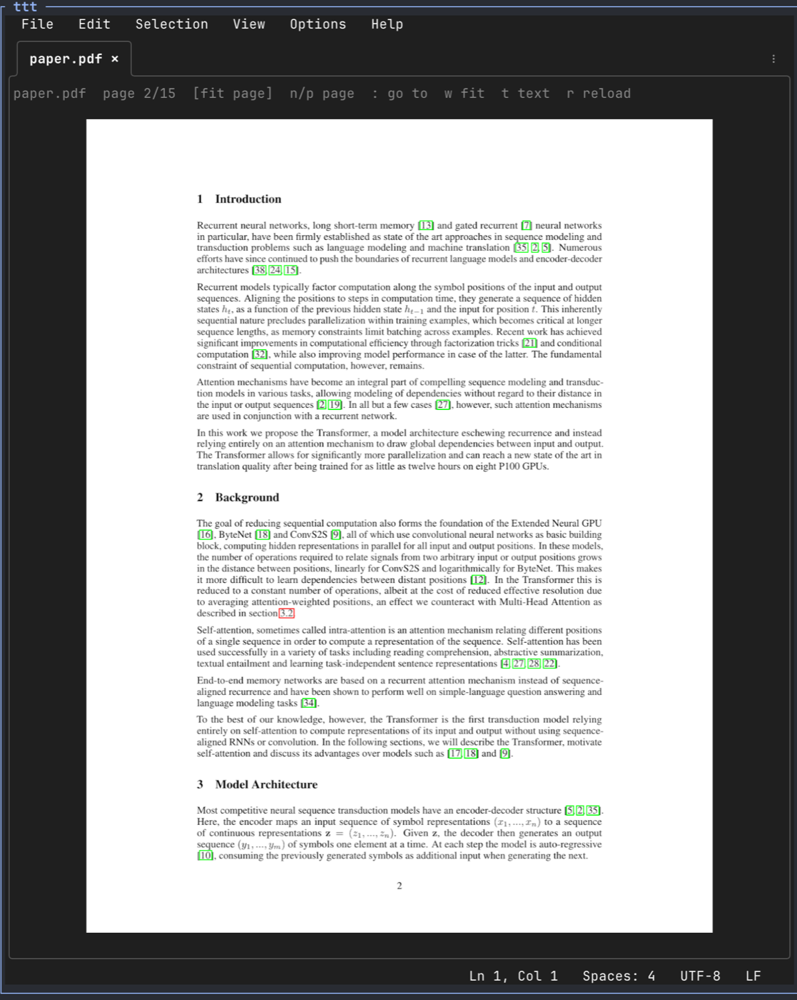

# pdf-viewer for ttt

[](https://github.com/sercanatalik/ttt-pdf/actions/workflows/test.yml)

Quick-look PDFs inside [ttt](https://github.com/eugenioenko/ttt). Open a `.pdf` from the explorer or the command line and it shows one page at a time in an editor tab. Terminals with the Kitty graphics protocol (Kitty, Ghostty, WezTerm) show the rendered page, and so does [herdr](#inside-herdr). Other terminals, and tmux, show the page's text instead.

<p align="center">
  
</p>

> **Status:** early. It needs a ttt build with plugin file handlers and the image widget, proposed in [eugenioenko/ttt#813](https://github.com/eugenioenko/ttt/issues/813). Older ttt versions keep showing PDFs as binary files.

## Requirements

- ttt with plugin file handlers (and `ttt.graphics()` for page images)
- [poppler](https://poppler.freedesktop.org/) command-line tools: `pdfinfo`, `pdftoppm`, `pdftotext`

| Platform | Install poppler |
|----------|-----------------|
| macOS    | `brew install poppler` |
| Debian/Ubuntu | `sudo apt install poppler-utils` |
| Fedora   | `sudo dnf install poppler-utils` |

## Install

In ttt, run **Plugins: Install from URL** and enter `https://github.com/sercanatalik/ttt-pdf`, then approve the permissions.

Or clone it into your config directory:

```sh
git clone https://github.com/sercanatalik/ttt-pdf ~/.config/ttt/plugins/pdf-viewer
```

## Inside herdr

[herdr](https://herdr.dev) works too: the screenshot above is ttt running in a herdr pane, opened by ttt's own herdr plugin, **TTT Editor**.

1. Install the TTT Editor plugin for herdr:

   ```sh
   herdr plugin install eugenioenko/ttt/herdr-plugin
   ```

   It runs the `ttt` on your `PATH` with your normal ttt config, so install pdf-viewer [as above](#install). Until [eugenioenko/ttt#813](https://github.com/eugenioenko/ttt/issues/813) is merged, that `ttt` has to be a build of [`sercanatalik/ttt@feat/plugin-image-widget`](https://github.com/sercanatalik/ttt/tree/feat/plugin-image-widget).

2. Turn on herdr's Kitty graphics support. It's experimental and needs herdr 0.5.9 or newer:

   ```toml
   # ~/.config/herdr/config.toml
   [experimental]
   kitty_graphics = true
   ```

   Restart herdr after changing it. Without it herdr doesn't draw images, so the page area stays empty; press `t` to read the page as text.

3. In herdr, open TTT Editor (the **Open TTT** action, or `herdr plugin pane open --plugin ttt.editor --entrypoint editor`) and open a PDF from the explorer.

## Keys

| Key | Action |
|-----|--------|
| `n` / `→` | Next page |
| `p` / `←` | Previous page |
| `Space` / `PgDn` | Next screen: scrolls down the page in fit width, then continues on the next page |
| `b` / `PgUp` | Previous screen: scrolls up, then continues at the bottom of the previous page |
| `g` / `Home`, `G` / `End` | First / last page |
| `:` | Go to a page: a number, `$` for the last page, or `+N` / `-N` relative to the current one |
| `w` | Switch between **fit page** (whole page visible) and **fit width** (page as wide as the tab, scroll vertically) |
| `j` / `k`, `↓` / `↑`, mouse wheel | Scroll (fit width and text); the wheel turns pages in fit page |
| `t` | Toggle between the page image and its text |
| `r` | Reload the file now. Usually not needed: the viewer reloads by itself when the PDF changes on disk |

## Permissions

| Permission | Why |
|------------|-----|
| `editor.file_handlers` | Open `.pdf` files (and files starting with `%PDF-`) in this viewer instead of the binary file card. |
| `keybindings` | Show the `:` go-to-page prompt (`ttt.command_line`). The plugin binds no global keys; its keys only work while a PDF tab is focused. |
| `events.file` | Know when a PDF tab closes, so it stops watching that file for changes. |
| `system.exec`: `pdfinfo`, `pdftoppm`, `pdftotext` | Read the page count and size, render a page to PNG, and extract a page's text. No other programs are run. |

The plugin reads no other files, makes no network requests, and stores nothing.

## How it works

- `pdfinfo` gives the page count when the file opens, then each page's size and rotation, so landscape and rotated pages in a portrait document fill the tab too.
- **Fit page** renders each page with `pdftoppm` at the largest resolution that fits the whole page in the tab, from the terminal's cell size in pixels. It's rounded down to a multiple of 8 so small resizes don't re-render, and kept between 24 and 300 DPI.
- **Fit width** picks the resolution that makes the page as wide as the tab and renders only the visible slice (`pdftoppm -x -y -W -H`), so tall pages never get rasterized in full. Scrolling renders the next slice, which is fetched ahead of time.
- The PNG goes to `panel:image`, which sends it to the terminal once. The current page and its neighbours stay cached, and the next page is rendered ahead of time.
- In text mode, `pdftotext -layout` extracts just the current page.
- **Auto-reload:** while a PDF tab is open, `pdfinfo` runs once a second. Its output includes the page count, file size, page size and modification dates, so a rebuild changes it. A change is only applied once two checks in a row agree, and a check that fails (file missing or still being written) is ignored. That way a LaTeX build in progress never shows a broken page. The reload keeps your page, scroll position and fit mode, and the old image stays up until the new one is rendered.
- All poppler calls run asynchronously, so a slow page never blocks the editor. A reload drops results that were still in flight.

## Limitations

- One page at a time in fit page; fit width scrolls within a page and steps to the next one. No arbitrary zoom levels, search, or links.
- In fit width each scroll step sends a new slice to the terminal (about 1 MB per screen at 1200 px wide), which is fine locally but slow over SSH.
- Page images need a terminal with the Kitty graphics protocol. They work inside herdr with `kitty_graphics` enabled, but not inside tmux.
- Password-protected PDFs (ones that need a password to open) aren't supported yet; the tab says so. PDFs that only restrict printing or copying open normally.
- Scanned PDFs have no text, so text mode shows nothing for them.

## Development

```sh
TTT_BIN=/path/to/ttt tests/run.sh
```

`tests/run.sh` installs the plugin into a throwaway config with its manifest permissions, then drives the real `ttt` binary:

- **Text mode**, headlessly with `--exec`: opening, paging and its bounds, go to page, reload, a corrupt file, an encrypted file, and missing poppler.
- **Image mode**, with `tests/kitty.py` (needs `python3`): it runs ttt in a pseudo-terminal that reports pixel sizes the way Ghostty does, drives it over `--listen` (port 4242 must be free), and decodes the Kitty graphics commands ttt sends. The checks cover fit page, fit width, scrolling across pages, mixed page sizes and rotation, that idle redraws send nothing, and auto-reload (a half-written file is ignored; a rebuilt one reloads in place). Decoded images land in the temp dir, which is handy when debugging.

`tests/make_fixture.py` regenerates the fixtures in `tests/fixtures/`.

## License

MIT
